# Developer Portfolio — AWS deployment

GitHub repository: `SatyamMauryakit/Replit_porject`.

This repository currently contains a React/Vite developer portfolio and a small
Express API. These deployment files adapt the attached AWS workflow brief to
the code that is actually in this workspace.

> The attached brief names a different product, “Pet Friendly Places India,”
> and specifies FastAPI and OpenStreetMap. Those features and that Python
> backend are not present here, so this deployment does not add or pretend to
> deploy them.

## What is in this repository

- **Frontend:** React, Vite, TypeScript, Tailwind CSS, in
  `artifacts/dev-portfolio/`.
- **API:** Node.js and Express 5, in `artifacts/api-server/`. At present it
  provides `/api/healthz`; the portfolio content itself is editable frontend
  sample data, not a MongoDB-backed CMS.
- **Workspace:** pnpm 10.26.1 lockfile and pnpm monorepo.
- **Production topology:** separate web and API containers. The web container
  serves the built single-page app and forwards `/api/*` to the API container.
  The API port is not published to the EC2 host.
- **AWS edge:** host Nginx listens on ports 80/443 and forwards to the active
  web container. The deployment script keeps two Compose slots so it can
  health-check a new version before changing Nginx.

The GitHub repository is the deployment source, and the Replit backup remote is
left intact. The AWS pipeline is prepared but is **not live** until Docker Hub,
an EC2 host, and the required GitHub settings are configured.

## Deployment architecture

See [`deploy/architecture.mmd`](deploy/architecture.mmd) for the Mermaid
diagram.

```mermaid
flowchart LR
    Dev[Developer edits in Replit] -->|Stage, commit, push| GitHub[Private GitHub repository]
    GitHub -->|Push to main or manual run on main| Actions[GitHub Actions]
    Actions --> Checks[Install locked dependencies, lint/tests if present, typecheck, build]
    Checks -->|Only after success| Images[Build commit-SHA-tagged API and web images]
    Images -->|Push| Hub[Docker Hub]
    Actions -->|SSH with pinned host key| DeployUser[Restricted EC2 deploy user]
    DeployUser -->|sudo allowlisted deploy script| Script[Blue/green deployment script]
    Hub -->|Pull exact commit SHA| Script
    Script -->|Start and health-check inactive slot| Compose[Docker Compose on private network]
    Compose --> Web[Unprivileged Nginx container, port 8080]
    Compose --> API[Express API container, port 5000]
    HostNginx[Host Nginx, HTTP/HTTPS 80/443] -->|Active slot 18080 or 18081| Web
    Web -->|/api/*| API
    Script -->|Switch upstream only after healthy checks| HostNginx
```



## What each deployment file does

| File | Purpose and when it runs |
| --- | --- |
| `deploy/Dockerfile.frontend` | Installs the locked workspace dependencies, builds the Vite site, and copies only the static output into an unprivileged Nginx image. |
| `deploy/Dockerfile.api` | Builds the Express server in a Node build stage, then runs its bundled output as the non-root `node` user. |
| `deploy/nginx/container.conf` | Serves the SPA, supports client-side routes, and proxies `/api/*` to Express over Docker's private network. |
| `compose.yaml` | Defines the API and web containers, health checks, restart policy, and a loopback-only web port. It can also build locally. |
| `.github/workflows/deploy.yml` | Pull requests to `main` run workspace checks and Docker image builds without publishing or deploying. Pushes to `main` and manual runs on `main` publish commit-SHA-tagged images and deploy that SHA. |
| `deploy/deploy.sh` | Runs on EC2. It updates the inactive Compose slot, checks the site and API, switches the host Nginx upstream only after checks pass, and retains the previous slot for rollback. |
| `deploy/nginx/developer-portfolio.conf` | Host-level Nginx reverse proxy. Replace the example hostname before enabling HTTPS. |
| `deploy/nginx/developer-portfolio-upstream.conf` | Initial host Nginx target. The deployment script changes this include atomically between ports 18080 and 18081. |
| `.env.example` | Safe, non-secret defaults for local Compose builds. It is not used by the EC2 deploy script. |
| `.dockerignore` | Keeps Git metadata, dependencies, secrets, generated files, and uploaded prompt files out of Docker build contexts. |

## GitHub and Replit source workflow

The GitHub connection is attached to this Replit project, and the selected
repository is `SatyamMauryakit/Replit_porject`. Confirm its visibility is
Private in GitHub. The repository's existing `main` history is preserved; the
deployment setup is being prepared on a separate branch for review.

Replit autosaves editor changes, but its Git integration does **not** push every
edit automatically. Stage, commit, and push changes. Pull requests to `main`
run checks and build both Docker images but do not publish or deploy. Merging to
`main` starts image publishing and the EC2 deployment, so configure all
repository variables and secrets before merging.

If the workflow reaches `main` before its repository settings are configured,
validation can still run, but image publishing and EC2 deployment will stop at
their missing-setting checks.

## GitHub repository settings

In the private repository, open **Settings → Secrets and variables → Actions**.
Add these **repository variables**:

| Variable | Example / meaning |
| --- | --- |
| `DOCKERHUB_IMAGE` | Docker Hub namespace and base repository, such as `myaccount/developer-portfolio`. The workflow adds `-api` and `-web` to create the two image names. |
| `EC2_HOST` | EC2 Elastic IP address or public DNS name. |
| `EC2_USER` | The dedicated deployment login, normally `deploy`. |

Add these **repository secrets**:

| Secret | Meaning |
| --- | --- |
| `DOCKERHUB_USERNAME` | Docker Hub account or robot-account username with permission to push. |
| `DOCKERHUB_TOKEN` | Docker Hub access token with the minimum permissions needed to publish images. |
| `EC2_SSH_PRIVATE_KEY` | Private half of the dedicated deploy user's SSH key. Never commit or paste it into chat. |
| `EC2_SSH_KNOWN_HOSTS` | The verified EC2 SSH host-key line(s), obtained and checked out-of-band. |

For a private Docker Hub repository, the EC2 host also needs a **read-only**
Docker Hub token for image pulls. Log in on EC2 as root using `docker login
--password-stdin`; Docker stores the credential in root's protected Docker
configuration. Do not put the pull token in this repository or in the image.
If the images are public, EC2 does not need this login.

### SSH key and host verification

Generate a dedicated key on a trusted local machine:

```sh
ssh-keygen -t ed25519 -f github-actions-deploy -C github-actions-deploy -N ''
```

Install `github-actions-deploy.pub` in the EC2 `deploy` user's
`~/.ssh/authorized_keys`. Save the private key as the GitHub
`EC2_SSH_PRIVATE_KEY` secret.

Obtain the EC2 SSH host key, then verify its fingerprint using an independent
trusted channel before saving its known-hosts line(s) as
`EC2_SSH_KNOWN_HOSTS`. `ssh-keyscan` can collect a key, but does not prove the
key belongs to your instance by itself. The workflow enforces strict host-key
checking and does not disable SSH verification.

GitHub-hosted runner IP ranges change. Do not open SSH to `0.0.0.0/0`. Allow
SSH only from a maintained GitHub Actions runner IP allowlist, use a
GitHub-hosted larger runner with a static IP where available, or use a
self-hosted runner / AWS Systems Manager design with private network access.
Keep web ports 80 and 443 public; restrict SSH to the deployment path you
choose.

## Prepare an Ubuntu EC2 host

Use an Ubuntu 24.04 LTS **x86_64/amd64** instance for the provided image build
target. Assign an Elastic IP if you need a stable DNS destination. In the EC2
security group, allow inbound TCP 80 and 443 from the internet. Restrict TCP 22
as described above. Do not open container ports 5000, 18080, or 18081 publicly.

Install Docker Engine, Compose, Nginx, and Certbot on the instance:

```sh
sudo apt-get update
sudo apt-get install -y ca-certificates curl gnupg nginx certbot python3-certbot-nginx

sudo install -m 0755 -d /etc/apt/keyrings
curl -fsSL https://download.docker.com/linux/ubuntu/gpg \
  | sudo gpg --dearmor --yes -o /etc/apt/keyrings/docker.gpg
sudo chmod a+r /etc/apt/keyrings/docker.gpg

printf '%s\n' \
  'Types: deb' \
  'URIs: https://download.docker.com/linux/ubuntu' \
  "Suites: $(. /etc/os-release && printf '%s' "$VERSION_CODENAME")" \
  'Components: stable' \
  "Architectures: $(dpkg --print-architecture)" \
  'Signed-By: /etc/apt/keyrings/docker.gpg' \
  | sudo tee /etc/apt/sources.list.d/docker.sources >/dev/null

sudo apt-get update
sudo apt-get install -y docker-ce docker-ce-cli containerd.io docker-buildx-plugin docker-compose-plugin
sudo systemctl enable --now docker
sudo systemctl enable --now nginx
```

Create the restricted deployment account. Do **not** add it to the `docker`
group; membership in that group is effectively root access. The only password-
less sudo permission granted below is the root-owned deployment script, which
validates the SHA and Docker Hub image arguments.

```sh
sudo adduser --disabled-password --gecos '' deploy
sudo install -d -o deploy -g deploy -m 0700 /home/deploy/.ssh
sudo install -o deploy -g deploy -m 0600 /dev/null /home/deploy/.ssh/authorized_keys
sudoedit /home/deploy/.ssh/authorized_keys
```

Paste the public key for the dedicated Actions key into `authorized_keys`, one
line, then check its ownership and permissions:

```sh
sudo chown deploy:deploy /home/deploy/.ssh/authorized_keys
sudo chmod 0600 /home/deploy/.ssh/authorized_keys
```

From a trusted clone of this repository on the instance, or by securely
transferring the files to it, install the Compose file and deployment script.
The GitHub workflow publishes and deploys application images; it does not copy
or replace these root-owned EC2 control files.

```sh
sudo install -d -o root -g root -m 0755 /opt/developer-portfolio
sudo install -o root -g root -m 0644 compose.yaml /opt/developer-portfolio/compose.yaml
sudo install -o root -g root -m 0755 deploy/deploy.sh /usr/local/sbin/developer-portfolio-deploy
sudo install -d -o root -g root -m 0755 /var/lib/developer-portfolio
```

Install the host Nginx site and initial upstream include. First edit
`deploy/nginx/developer-portfolio.conf` to use your real domain; preserve any
existing Nginx sites on the instance.

```sh
sudo install -d -o root -g root -m 0755 /etc/nginx/snippets
sudo install -o root -g root -m 0644 \
  deploy/nginx/developer-portfolio-upstream.conf \
  /etc/nginx/snippets/developer-portfolio-upstream.conf
sudo install -o root -g root -m 0644 \
  deploy/nginx/developer-portfolio.conf \
  /etc/nginx/sites-available/developer-portfolio
sudo ln -s /etc/nginx/sites-available/developer-portfolio \
  /etc/nginx/sites-enabled/developer-portfolio
```

If the symlink already exists, inspect it rather than replacing it. Test the
complete Nginx configuration before reloading:

```sh
sudo nginx -t
sudo systemctl reload nginx
```

Grant the deploy account permission to run only the validating release script:

```sh
printf '%s\n' \
  'deploy ALL=(root) NOPASSWD: /usr/local/sbin/developer-portfolio-deploy *' \
  | sudo tee /etc/sudoers.d/developer-portfolio-deploy >/dev/null
sudo chmod 0440 /etc/sudoers.d/developer-portfolio-deploy
sudo visudo -cf /etc/sudoers.d/developer-portfolio-deploy
```

For private Docker Hub images, perform the login on EC2 without putting the
token in shell history:

```sh
read -r -p 'Docker Hub username: ' DOCKERHUB_USERNAME
read -r -s -p 'Read-only Docker Hub token: ' DOCKERHUB_PULL_TOKEN
printf '\n'
printf '%s' "$DOCKERHUB_PULL_TOKEN" \
  | sudo docker login --username "$DOCKERHUB_USERNAME" --password-stdin
unset DOCKERHUB_USERNAME DOCKERHUB_PULL_TOKEN
sudo chmod 0600 /root/.docker/config.json
```

## Domain and HTTPS

1. Point the domain's DNS A record to the EC2 Elastic IP. Add an AAAA record
   only if IPv6 is configured on the instance and security group.
2. Replace `your-domain.example` in the host Nginx configuration and reload
   after `sudo nginx -t` succeeds.
3. Once public DNS resolves to the instance and ports 80/443 are reachable,
   request a certificate:

   ```sh
   sudo certbot --nginx -d your-real-domain.example --redirect
   sudo certbot renew --dry-run
   ```

Certbot updates the host Nginx site to handle HTTPS and redirect HTTP. The host
Nginx process is separate from the Docker Compose application and remains
running when a portfolio release changes.

## First deployment and verification

The GitHub Actions workflow deploys an image only after checks pass and both
commit-SHA-tagged images have been pushed. On the first release, the script starts the
blue slot, checks `/` and `/api/healthz`, then points host Nginx to port 18080.
Later deployments use the other slot (18081), and only switch traffic after
the candidate is healthy.

After the first Actions run, verify from EC2:

```sh
sudo docker compose \
  --project-name developer-portfolio-blue \
  --file /opt/developer-portfolio/compose.yaml ps
sudo cat /var/lib/developer-portfolio/active-slot
sudo tail -n 50 /var/log/developer-portfolio-deploy.log
curl --fail --show-error http://127.0.0.1:18080/
curl --fail --show-error http://127.0.0.1:18080/api/healthz
```

Use the actual active port (18080 or 18081) for the `curl` checks. Then visit
the real domain over HTTPS.

To roll back to the previous healthy slot:

```sh
sudo /usr/local/sbin/developer-portfolio-deploy rollback \
  your-dockerhub-namespace/developer-portfolio
```

The script checks the previous slot before switching host Nginx. It retains the
current and previous SHA-tagged images and removes only older 40-character
SHA-tags for this app, without force-removing images still in use. Both slots
remain running to keep rollback quick; account for that resource use on a small
EC2 instance.

## Local validation

Run from the repository root:

```sh
pnpm install --frozen-lockfile
pnpm -r --if-present run lint
pnpm -r --if-present run test
pnpm run typecheck
PORT=19980 BASE_PATH=/ pnpm --filter @workspace/dev-portfolio run build
pnpm --filter @workspace/api-server run build
```

There are currently no lint or test scripts in the workspace, so those
commands are safe no-ops until such scripts are added. The CI workflow runs
them when present.

To build and run both containers locally:

```sh
docker compose --env-file .env.example config --quiet
docker compose --env-file .env.example build
docker compose --env-file .env.example up --detach --wait
curl --fail --show-error http://127.0.0.1:18080/
curl --fail --show-error http://127.0.0.1:18080/api/healthz
docker compose --env-file .env.example down
```

## Required GitHub Actions settings checklist

- [ ] Private GitHub repository is connected and has a `main` branch.
- [ ] Docker Hub repositories exist for `<namespace>/<base>-api` and
  `<namespace>/<base>-web`; the workflow pushes SHA tags.
- [ ] `DOCKERHUB_IMAGE`, `EC2_HOST`, and `EC2_USER` repository variables are set.
- [ ] `DOCKERHUB_USERNAME` and `DOCKERHUB_TOKEN` repository secrets are set.
- [ ] EC2 SSH private-key and verified host-key secrets are set.
- [ ] EC2 is Ubuntu 24.04 x86_64, has Docker, Compose, host Nginx, and Certbot.
- [ ] EC2 has the deploy account, authorized public key, root-owned deployment
  script, Compose file, Nginx site, and restricted sudo rule.
- [ ] EC2 security group allows 80/443 and restricts SSH to the chosen
  deployment access path.
- [ ] For private images, the EC2 root Docker client is authenticated for pulls.
- [ ] DNS resolves to the EC2 Elastic IP before requesting HTTPS.

## Troubleshooting

| Symptom | Checks |
| --- | --- |
| Workflow stops before building images | Confirm `pnpm install --frozen-lockfile`, typecheck, frontend build, and API build logs. A failed check prevents publishing and deployment. |
| Docker Hub login or push fails | Verify the repository secrets, token write permission, Docker Hub namespace, and both image repositories. |
| SSH fails in Actions | Verify `EC2_HOST`, `EC2_USER`, the matching public key in `authorized_keys`, the private-key secret, the verified known-hosts secret, and port 22 reachability from the chosen runner network. |
| `sudo` asks for a password | Check `/etc/sudoers.d/developer-portfolio-deploy` with `visudo -cf`; the remote command must use `sudo -n`. |
| Image pull fails on EC2 | For private repositories, confirm root's `docker login` works and the token has read access. |
| Candidate containers are unhealthy | Check `docker compose -p developer-portfolio-blue -f /opt/developer-portfolio/compose.yaml logs` (or `green`) and the deploy log. The active Nginx target is unchanged if health checks fail. |
| Nginx returns 502 | Check `sudo nginx -t`, the upstream include, the active slot port, and that the web and API containers are healthy. |
| HTTPS certificate request fails | Confirm DNS A/AAAA records, port 80 ingress, real `server_name`, and that no proxy/CDN is intercepting the ACME challenge. |
| A Replit edit did not deploy | Stage, commit, and push it to GitHub `main`; editor autosave does not trigger GitHub Actions. |

## Important scope and security notes

- This workflow targets the **portfolio code currently in this repository**.
  It does not create the unrelated FastAPI/OpenStreetMap application named in
  the attached brief.
- Commit-SHA image tags make releases traceable, but Docker Hub does not make
  tags immutable by name alone. Configure tag immutability in the registry or
  use digest-pinned releases if you require registry-enforced immutability.
- The current Express server only provides a health check. The portfolio
  currently uses local sample data and has no MongoDB-backed editing or saved
  contact form.
- No AWS account, EC2 host, GitHub repository, Docker Hub token, SSH key, DNS
  name, or MongoDB connection was supplied or configured here. The files are
  deployment-ready scaffolding, not evidence of a live AWS deployment.
- Do not commit `.env`, private keys, Docker credentials, or other secrets.
  `EC2_SSH_PRIVATE_KEY` and Docker Hub write access belong in GitHub Secrets.
- Keep the EC2 SSH ingress restricted. GitHub-hosted runner ranges change; do
  not solve connectivity by allowing SSH from the whole internet.

## Official references

- [Replit Git interface](https://docs.replit.com/features/workspace-tools/git-interface)
- [Replit version control](https://docs.replit.com/learn/projects-and-artifacts/version-control)
- [GitHub Actions workflow syntax](https://docs.github.com/actions/using-workflows/workflow-syntax-for-github-actions)
- [GitHub Actions secure use](https://docs.github.com/actions/security-for-github-actions/security-guides/security-hardening-for-github-actions)
- [Docker Engine on Ubuntu](https://docs.docker.com/engine/install/ubuntu/)
- [Docker Compose](https://docs.docker.com/compose/)
- [AWS EC2 security groups](https://docs.aws.amazon.com/AWSEC2/latest/UserGuide/ec2-security-groups.html)
- [Certbot with Nginx](https://certbot.eff.org/instructions?ws=nginx&os=ubuntufocal)
